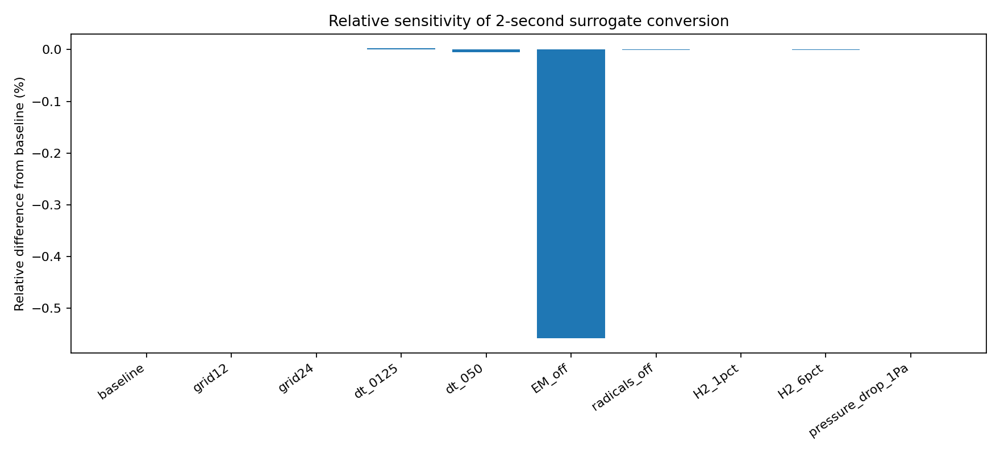

# ReInduct-CFD | Reactive battery-recycling modelling research portfolio

[](docs/REPRODUCIBILITY.md)


**ReInduct-CFD is an openly documented numerical research prototype, not a validated industrial battery-recycling digital twin.** The active implementation is a **one-dimensional porous-gas reactive surrogate** supported by a separate **axisymmetric magnetoquasistatic induction-heating model**. It is intended to demonstrate numerical modelling, conservation checks, multiphysics coupling methods, and scientific software verification.

<p align="center"></p>

## What's implemented

- **Reactive gas–solid model:** illustrative LiCoO₂/C reaction paths; transport of CO, CO₂, N₂, H₂ and H; evolving solid inventories. Rates inherited from literature-derived *proxies*, not validated reactor kinetics.
- **Pressure–temperature correction:** conservative molar transport, Darcy–Ergun pressure closure, ideal-gas equation of state and iterative pressure–sensible-enthalpy update.
- **Temperature-dependent gas thermodynamics:** NIST Shomate sensible-enthalpy and heat-capacity coefficients for CO/CO₂/N₂/H₂ and ideal monatomic H heat capacity. **Solid reaction formation enthalpies are not included.**
- **Induction-heating feedback:** axisymmetric electromagnetic heating mapped to the reactor and refreshed with nonlinear temperature-dependent electrical conductivity; refresh intervals and lagged source terms limit the coupling.
- **Scientific verification:** tests of elemental and numerical energy ledgers, positivity, pressure closure, convergence/sensitivity screening, and Python/C++17 thermochemistry cross-check.

## Quick start

Tested on Linux with **Python 3.11+**, `make`, `g++` and standard scientific Python dependencies. Python environment should be kept separate from system Python.

```bash
sudo apt-get install -y python3-venv python3-pip make g++
python3 -m venv .venv
source .venv/bin/activate
python -m pip install -r requirements.txt
make verify
```

`make verify` runs the Python test suite, compiles/tests the standalone C++17 thermochemistry cross-check, generates a short numerical case and writes an evidence manifest. **It does not run OpenFOAM.**

For the longer sensitivity sweep:

```bash
make study
```

If you want to inspect the generated fields or verification report, see `v13/results/final_5s/` and `v13/results/EVIDENCE_MANIFEST.json` after execution. Generated results are intentionally `.gitignore`d. A representative output and figures are stored in [`docs/examples/`](docs/examples/) and [`docs/figures/`](docs/figures/).

## Scientific status (read before using results)

| Domain | Status | Boundary of claim |
|---|---|---|
| Python finite-volume reactive surrogate | Numerically tested | Not full Navier–Stokes CFD |
| Gas–solid coupling | Reduced-order two-temperature model | No moving-solid Eulerian–Eulerian / CFD–DEM |
| Temperature-dependent gas sensible properties | Implemented and tested | No complete solid formation enthalpy model |
| Electromagnetic induction / heating feedback | Reduced-order coupled computation | Not full MHD or calibrated plasma |
| C++17 | Standalone thermochemical regression tested | No validated OpenFOAM v13 C++ solver |
| OpenFOAM runtime | **Not verified** | Historical candidate kept only for reference |
| Laboratory / industrial reactor validation | **Not performed** | No matching independent reactor dataset |

**153 historical + current numerical tests passed in the preparation environment.** These verify implemented equations and code paths. They do **not** prove physical accuracy or industrial predictive performance. A live CI badge was deliberately not created; the badge above reflects the local test result and should not be interpreted as GitHub Actions success.

## Layout

```text
v13/             Active research surrogate, C++ check, numerical tests, evidence tools
v4/ ... v12/     Historical modules required for the v13 model and regression tests
cfd/, em/, ...  Early stand-alone numerical experiments
v13/openfoam/    Explicitly blocked v13 OpenFOAM execution (no equivalent solver)
.github/workflows/  One numerical-verification CI workflow (not an OpenFOAM test)
docs/            Reproduction instructions, model limitations, figures, earlier reports
```

**For a new project, start in `v13/reactor.py`, `v13/thermo_pressure.py`, `v13/em_feedback.py` and `v13/tests/test_v13.py`.** Earlier versions are preserved as dependencies / development history, not as multiple competing validated products.

## Sources, license and citation

- Nuraeni et al. (2023), *Recovery of Cobalt and Lithium by Carbothermic Reduction of LiCoO₂ Cathode Material: A Kinetic Study*: https://pmc.ncbi.nlm.nih.gov/articles/PMC9821372/ — provides an experimental kinetics reference, **not** independent validation of this reactor.
- NIST Chemistry WebBook: CO, CO₂, N₂, H₂ Shomate parameters; URLs and scope in [`docs/SCIENTIFIC_LIMITATIONS.md`](docs/SCIENTIFIC_LIMITATIONS.md).
- OpenFOAM: https://www.openfoam.com/ — a *potential future target*, not a successfully run v13 backend.

Code is distributed under the [MIT license](LICENSE). Third-party sources and datasets retain their original rights and must be cited separately. See [CITATION.md](CITATION.md) for how to describe the project without inventing a DOI.

**فارسی:** [خلاصه و روش اجرا](README_FA.md) · [راهنمای انتشار روی GitHub](docs/GITHUB_PUBLISH_FA.md). **Reproducibility:** [exact verification instructions](docs/REPRODUCIBILITY.md). **Unresolved research gaps:** [scientific limitations](docs/SCIENTIFIC_LIMITATIONS.md).
